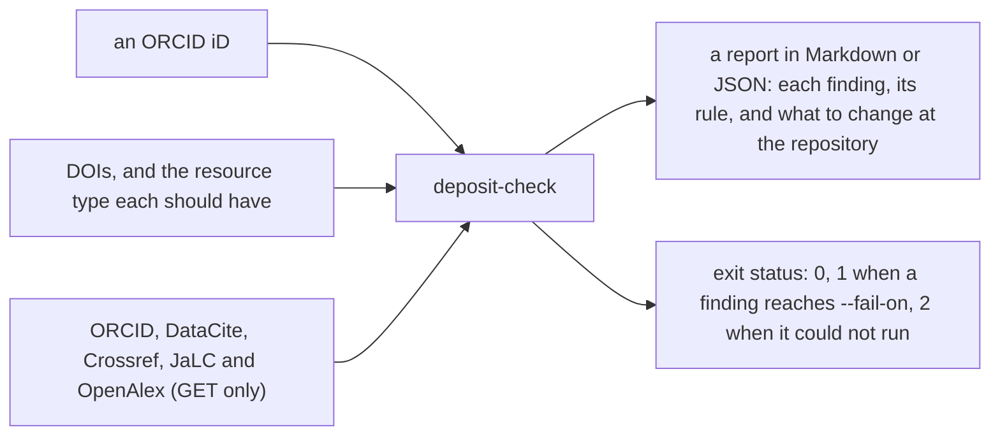

# deposit-check

種類：ソフトウェア　状態：改訂中

Type: Software · Status: In revision

deposit-check reads the DOI metadata of a researcher's works and says what is missing or inconsistent.
Indexes such as OpenAlex and Google Scholar, ORCID's automatic updates and the readers of a repository read this metadata, not the PDF.
A deposit with no abstract or licence in its metadata, or with the author's ORCID iD left off, is harder to find, to credit and to reuse.

Give it an ORCID iD, and it reads:

- the works with a DOI on the public ORCID record;
- the works whose DataCite or Crossref metadata carries that iD, on the record or not;
- the metadata of each DOI, from DataCite, Crossref or JaLC;
- how OpenAlex holds each work: whether it has the work and its abstract.

Then it checks each work against the rules below, and writes a report in Markdown or JSON.
It changes nothing anywhere: every request is a GET to a public API.



To try it in a minute, without the network, see [`examples/`](examples/).
A run over the author's own works, with what it found, is kept in [`docs/runs/2026-11-11-catalog/`](docs/runs/2026-11-11-catalog/).

## Use

Node.js 22 or later. There are no dependencies to install: the tool uses only the standard library of Node.js, and `verification/check.js` checks that every module it loads is either part of Node.js or one of its own files.

```
node bin/deposit-check.js --orcid 0000-0002-1825-0097
node bin/deposit-check.js --doi 10.5281/zenodo.1234567 --doi 10.6084/m9.figshare.7654321.v2
node bin/deposit-check.js --orcid 0000-0002-1825-0097 --format json --fail-on warning
```

| Option | |
| --- | --- |
| `--orcid <iD>` | Check the works of this ORCID iD. The iD may also be given as its URL. A wrong check digit is refused before any request. |
| `--doi <DOI>` | Check this DOI as well. May be given more than once. |
| `--expect-types <file>` | A JSON file of DOIs and the resource type each should have (see below). Each DOI in it is checked as well. |
| `--expect-identical <file>` | A JSON file of DOIs and the copies of the same text each should be linked to (see below). Each DOI in it is checked as well. |
| `--format markdown\|json` | The report's format. Markdown by default. |
| `--fail-on error\|warning\|info\|never` | Exit 1 when a finding is this serious or more. `error` by default. |
| `--out <file>` | Write the report to a file as well. |
| `--json-out <file>` | Also write the report as JSON to a file, whatever `--format` is. |
| `--summary` | Also append the Markdown report to `$GITHUB_STEP_SUMMARY`. |
| `--answers <file>` | Read the answers of the APIs from a JSON file instead of the network. For the example in `examples/`, and for trying the action. |

The exit status is 0 when nothing reaches `--fail-on`, 1 when something does, and 2 when the tool could not run.

## As a GitHub Action

```yaml
- uses: cpsbvbng26-dotcom/deposit-check@main
  with:
    orcid: 0000-0002-1825-0097
    fail-on: never
```

The report is written to the job summary. Pin the action to a commit for a stable result.
The inputs are `orcid`, `dois` (separated by spaces or commas), `expect-types`, `expect-identical`, `fail-on`, `mailto` and `answers`.
Each reaches the command through the environment, never through the command line itself.
The repository's own CI uses the action on itself, on the example and without the network: the example passes, and fails once warnings count.

## Rules

| Rule | Severity | What it finds |
| --- | --- | --- |
| `abstract-missing` | error | No abstract in the DOI metadata |
| `abstract-short` | warning | The abstract is very short, or repeats the title |
| `licence-missing` | error | No licence in the DOI metadata |
| `licence-unreadable` | warning | The licence is given only in words |
| `owner-orcid-missing` | error | Your ORCID iD is not on your name in the DOI metadata |
| `creators-orcid-missing` | info | Some creators of a work with several creators have no ORCID iD in the DOI metadata |
| `type-generic` | warning | The resource type is missing or says only “Other” |
| `type-unexpected` | warning | The resource type differs from the type expected for the DOI |
| `date-missing` | warning | No full date of publication |
| `keywords-missing` | warning | No keywords |
| `language-missing` | info | No language |
| `version-unlinked` | warning | A version without a link to its other versions |
| `relations-none` | info | No related works |
| `identical-unlinked` | warning | A copy of the same text is not linked with IsIdenticalTo |
| `openalex-missing` | info | OpenAlex does not hold the work |
| `openalex-abstract-missing` | warning | The DOI metadata has an abstract, and OpenAlex has none |
| `unresolved` | error | A DOI on the ORCID record is not found at DataCite, Crossref or JaLC |
| `not-on-orcid` | warning | A work that carries your ORCID iD is not on your ORCID record |
| `same-title` | info | Two deposits with the same title that are not linked as versions or copies |

- **error:** the metadata is missing something that readers and indexes rely on.
- **warning:** something is probably wrong or incomplete.
- **info:** worth knowing, and often fine as it is.

The report gives, for each rule it raises, what to do at the repository.

The versions of one work are read together:
- Only the latest version that was read is checked. Older versions and the record of all versions repeat it, and every finding would come once for each.
- A work counts as on the ORCID record when any of its versions is, and a work missing from it is reported once.
- Zenodo ties versions with IsVersionOf to the record of all versions (its concept DOI). Figshare ties them by their DOIs (.v1, .v2 after the DOI of all versions).

### Expected types

A deposit can be registered under the wrong type: a program as a dataset, a preprint as a journal article. Nothing in the metadata says it is wrong, so `type-generic` cannot see it.
Give the type each DOI should have in a JSON file, as DataCite's `resourceTypeGeneral`:

```json
{
  "10.5281/zenodo.1234567": "Software",
  "10.6084/m9.figshare.7654321": "Preprint"
}
```

`--expect-types` reads it, checks each DOI in it, and raises `type-unexpected` where the registered `resourceTypeGeneral` differs. Case does not matter.
A type given for the DOI of all versions (Zenodo's concept DOI) holds for each version. Only records registered by DataCite are compared, since Crossref and JaLC name their types in other words. Keys that start with `_` are comments.

### Copies of the same text

A paper deposited at Zenodo may also be at SSRN, PhilArchive or another place. Unless the records are linked, indexes count two texts, and the citations are split between them. `same-title` notices two deposits with the same title, but a copy often has another title.
Give the copies of each DOI in a JSON file, as a DOI or a URL, one or a list:

```json
{
  "10.5281/zenodo.1234567": "10.2139/ssrn.7654321",
  "10.5281/zenodo.2345678": ["10.2139/ssrn.8765432", "https://philarchive.org/rec/EXAMPLE"]
}
```

`--expect-identical` reads it, checks each DOI in it, and raises `identical-unlinked` where neither record names the other with IsIdenticalTo.
One side is enough. An SSRN record cannot carry the link, and the Zenodo record can. A link of another type, such as IsVariantFormOf, does not count.
The key is the record that should carry the link. Copies given for one version hold for the version that is checked, so a new version that lost the link is found.

## What is sent where

The ORCID iD and the DOIs are sent, and nothing else. No key or account is needed.

| Host | What for |
| --- | --- |
| pub.orcid.org | The works on the ORCID record (public API, v3.0) |
| api.datacite.org | The metadata of a DOI, and the DOIs whose creators carry the iD (asked for both bare and as a URL, since Zenodo stores the bare iD and Figshare and OSF its URL) |
| api.crossref.org | The metadata of a DOI, and the DOIs whose authors carry the iD |
| api.japanlinkcenter.org | The metadata of a DOI registered by JaLC |
| api.openalex.org | Whether OpenAlex, the open index of scholarly works, holds each work and its abstract |

Requests are made one at a time, a moment apart. A refused or failed request is tried twice more, after 5 and 20 seconds.
Crossref asks callers to give a contact address. One can be given in the environment variable `DEPOSIT_CHECK_MAILTO` (or the action's `mailto` input); none is built in.
A DOI that cannot be read because of the network or an API is named in the report as such, not as a fault of the record.

## Limits

- It reads metadata. It does not judge the work, and it does not read the files.
- JaLC is not searched by ORCID iD. A work registered by JaLC is read when it is on the ORCID record or given with `--doi`.
- A rule can be wrong for a given work, for example a work that has no keywords on purpose. The severities are a guide.

## Checks

```
node verification/check.js
```

The checks run without the network. The answers of the APIs come from made-up records in `verification/fixtures`.
The checks break a complete record in 16 ways, one for each rule that reads a single record, and see that each break raises its rule and no other.
They run on every push and pull request, and once a week (`.github/workflows/check.yml`).
They also check the repository itself: no dependencies anywhere, workflows that only read except for the weekly issue, actions pinned to a commit, and no keys, tokens or e-mail addresses in any tracked file.
`.github/workflows/run.yml` runs the tool itself against the live APIs, by hand or once a week, and writes the report to the job summary and to an artifact of the run.
For the author's own iD it also reads every DOI in the catalogue of the author’s works (`catalog.json` in cpsbvbng26-dotcom, read from GitHub), with the type and the copies elsewhere that the catalogue gives each work (`scripts/catalog-inputs.js`).
It keeps one open issue with the latest report, and the findings of that report. When the findings change, it comments with the ones that are gone and the ones that are new. The issue closes itself when no error or warning is left.
The run commits nothing. Only this run talks to api.github.com, with the token GitHub gives the run, and it may write issues and nothing else.

## Citing

Each release is archived at Zenodo, with a DOI of its own:

| Version | DOI | Released | Changes |
| --- | --- | --- | --- |
| 0.1.0 | [10.5281/zenodo.24033082](https://doi.org/10.5281/zenodo.24033082) | 2026-11-07 | [0.1.0](CHANGELOG.md#010-2026-11-07) |
| Every version | [10.5281/zenodo.24033081](https://doi.org/10.5281/zenodo.24033081) | | Resolves to the latest version |

The rows follow `CHANGELOG.md` and the identifiers in `CITATION.cff`, and `verification/check.js` checks that they agree.
Cite the version you used. `CITATION.cff` gives the citation, and GitHub shows it as "Cite this repository".

## Contributing

Where each kind of contribution goes, and how to check a change, is in [CONTRIBUTING.md](CONTRIBUTING.md). The changes so far are in [CHANGELOG.md](CHANGELOG.md).

## Plans

A submission to the Journal of Open Source Software (JOSS) is planned.
JOSS asks for a repository public for more than six months; the first commit here is from 2026-11-02, so the earliest date is 2027-05-03.
A draft of the paper JOSS asks for is in `paper/paper.md` and `paper/paper.bib`. Its references carry no DOI until each is checked at its source.
There is no record yet of use by anyone but the author. Whether the tool is within the scope of JOSS is for JOSS to decide.

## Licence

The code is under the MIT licence ([LICENSE](LICENSE)). The text of this README and the other documents is under [CC BY 4.0](https://creativecommons.org/licenses/by/4.0/). Reuse of the text needs the attribution that Section 3 of that licence asks for: the author, a link to the licence, and whether the text was changed. The legal audit of 2026-11-12 found that this sentence named the licence without a link to it, while LICENSE, CITATION.cff and .zenodo.json name only the MIT licence; the link is now given. The split itself is unchanged.

## Use of language models

The code, the checks and this README were written with Claude Code (Anthropic), a language model, at the author's request.
The author decided the design and the rules, reviewed the output, and takes responsibility for it.
Claude is not an author. Each commit records the use.

| Tool | Used for | Checked by |
| --- | --- | --- |
| Claude Code (Anthropic) | The code, the checks, this README and `docs/` | The author (the design and the rules), and `verification/check.js` |

## 日本語

deposit-check は、研究者の業績の DOI の登録情報（メタデータ）を読み、欠けているものや食い違っているものを挙げる道具です。
OpenAlex や Google Scholar などの索引、ORCID の自動更新、リポジトリの読み手が読むのは、PDF ではなくこの登録情報です。
要旨やライセンスが登録情報に無い稿、著者の ORCID iD が付いていない稿は、見つけにくく、業績として結び付きにくく、再利用もしにくくなります。

- ORCID iD を一つ渡すと、ORCID の記録にある業績と、DataCite・Crossref でその iD を持つ業績を集めます。
- 各 DOI の登録情報を DataCite・Crossref・JaLC から読み、上の表の規則で点検します。
- 報告は Markdown か JSON で出します。
- 稿ごとに意図した種類を JSON の表で渡すと、登録した種類（DataCite の `resourceTypeGeneral`）との食い違いを知らせます。
- 同じ本文の写し（SSRN など）を JSON の表で渡すと、IsIdenticalTo で結ばれていない組を知らせます。片方の記録が相手を指していれば足ります。
- 毎週の実行は、著者の業績の目録（cpsbvbng26-dotcom の `catalog.json`）にあるすべての DOI も読みます。前の報告から指摘が変わると、消えた指摘と新しい指摘を issue に書きます。リポジトリには何もコミットしません。
- 依存はありません。Node.js の標準ライブラリだけで動きます。網に出ずに一分で試せる見本が `examples/` にあります。
- どこにも何も書き込みません。送るのは ORCID iD と DOI だけで、鍵もアカウントも要りません。

Journal of Open Source Software（JOSS）への投稿を計画しています。公開から六か月を超えたリポジトリが要るので、投稿できるのは最短で 2027-05-03 です。著者以外に使われた記録はまだありません。

版 0.1.0 は Zenodo に保存してあります（DOI [10.5281/zenodo.24033082](https://doi.org/10.5281/zenodo.24033082)）。
すべての版に共通する DOI は [10.5281/zenodo.24033081](https://doi.org/10.5281/zenodo.24033081) で、いちばん新しい版を指します。
引用するときは、使った版の DOI を挙げます。

コードは MIT、文書は CC BY 4.0 です。
コードと検査と文書は、言語モデル Claude Code（Anthropic）を使って書きました。設計と規則は著者が決め、出力を確かめ、責任を負います。Claude は著者ではありません。

© 2026 Takuya Nemoto ([ORCID 0009-0000-1406-0547](https://orcid.org/0009-0000-1406-0547))
